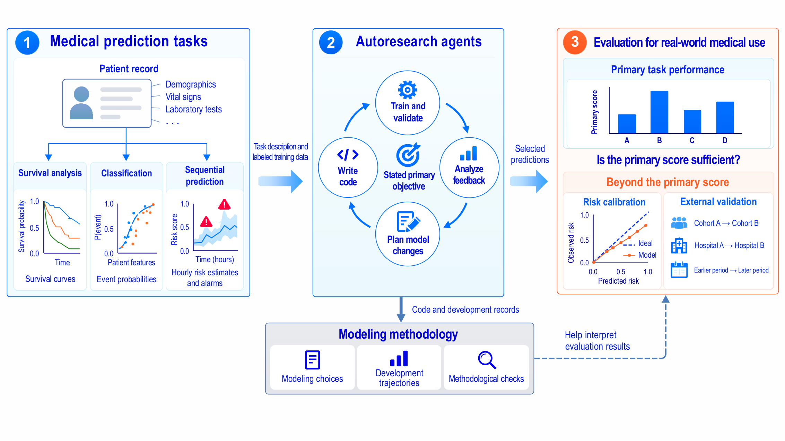

# Auto-MD-bench

Auto-MD-bench evaluates autoresearch agents that build prediction models for medical tasks. An agent
receives a task description and labeled training data, develops a model on its own within a fixed
time budget, and submits predictions for a hidden test set. Submissions are scored on the task's
primary metric and also on risk calibration and on performance under population shift.

The benchmark has 15 tasks from 10 clinical datasets: 7 survival analysis tasks, 5 classification
tasks and 3 sequential prediction tasks. Five tasks are external validations, with test data from
another cohort, hospital or time period.



**Contents**
[Tasks](#tasks) ·
[Install](#install) ·
[Build the tasks](#build-the-tasks) ·
[Grade a submission](#grade-a-submission) ·
[Run an agent](#run-an-agent) ·
[Protocol](#protocol) ·
[Scoring](#scoring) ·
[Reference models](#reference-models) ·
[Paper results](#paper-results) ·
[Repository layout](#repository-layout) ·
[Adding tasks and agents](#adding-tasks-and-agents)

## Tasks

| Task | Data | Outcome | Validation | Primary metric | Train / test |
|---|---|---|---|---|---|
| **Survival analysis** | | | | | |
| `support` | SUPPORT cohort | Death | Internal | C<sup>td</sup> | 7,098 / 1,775 |
| `metabric` | METABRIC cohort | Death | Internal | C<sup>td</sup> | 1,523 / 381 |
| `rotterdam` | Rotterdam cohort | Recurrence or death | Internal | C<sup>td</sup> | 2,385 / 597 |
| `rotterdam_gbsg` | Rotterdam → GBSG trial | Recurrence or death | External (cohort) | C<sup>td</sup> | 2,982 / 686 |
| `seer` | SEER registry ¹ | Breast-cancer death | Internal | C<sup>td</sup> | 232,625 / 49,291 |
| `seer_later_period` | SEER registry ¹ | Breast-cancer death | External (period) | C<sup>td</sup> | 183,334 / 49,291 |
| `nhanes` | NHANES survey | Death | Internal | C<sup>td</sup> | 11,639 / 2,910 |
| **Classification** | | | | | |
| `uci_diabetes` | UCI Diabetes, 130 US hospitals | 30-day readmission | Internal | AUROC | 81,347 / 20,419 encounters |
| `physionet2012` | PhysioNet/CinC 2012, ICU | In-hospital death | Internal | min(Se, PPV) | 4,000 / 8,000 stays |
| `mimiciv` | MIMIC-IV ², ICU | In-hospital death | Internal | AUROC | 41,471 / 10,368 |
| `eicu` | eICU-CRD ², ICU | In-hospital death | Internal | AUROC | 94,823 / 11,133 stays |
| `eicu_new_hospitals` | eICU-CRD ², ICU | In-hospital death | External (hospital) | AUROC | 83,626 / 11,133 stays |
| **Sequential prediction** | | | | | |
| `sepsis` | PhysioNet/CinC 2019, ICU | Sepsis onset | Internal | Utility | 32,268 / 8,068 |
| `sepsis_new_hospital` | PhysioNet/CinC 2019, ICU | Sepsis onset | External (hospital) | Utility | 20,336 / 4,000 |
| `sepsis_500_labels` | PhysioNet/CinC 2019, ICU | Sepsis onset | External (hospital) | Utility | 20,336 + 500 / 4,000 |

Sizes are patients unless noted. Tasks that share a data source share their test set: `seer` and
`seer_later_period`; `eicu` and `eicu_new_hospitals`; the three sepsis tasks use the same 4,000
hospital-B test patients (the `sepsis` test set also includes hospital-A patients).

¹ Needs a SEER Research Data Agreement. ² Needs PhysioNet credentialed access.
The other 10 tasks use public data.

Each task description is in `tasks/<dataset>/<task>.md`, exactly as the agents saw it.

## Install

Python 3.10 or later.

```bash
pip install -e .
```

The agents themselves run in a separate environment; see [Run an agent](#run-an-agent).

## Build the tasks

A task package is a folder `packages/<task>/` with two parts:

- `public/` is what the agent sees: `description.md`, training data, test features, a sample
  submission in the required format, and `validate.py`, a format checker.
- `private/` holds the hidden test labels.

**Public tasks.** Download the raw data of the 10 public tasks, then build them:

```bash
bash scripts/download_public_data.sh data/raw
bash scripts/build_public_tasks.sh data/raw packages
```

One dataset at a time: `python tasks/<dataset>/build.py RAW_DIR --out packages`.

**MIMIC-IV 3.1** (PhysioNet credentialed access):

```bash
bash tasks/mimiciv/extract.sh MIMIC_ROOT work/mimiciv
python tasks/mimiciv/build.py MIMIC_ROOT work/mimiciv --out packages
```

`MIMIC_ROOT` is the folder with `hosp/` and `icu/`.

**eICU-CRD 2.0** (PhysioNet credentialed access):

```bash
bash tasks/eicu/extract.sh EICU_DIR work/eicu
python tasks/eicu/build.py EICU_DIR work/eicu --out packages
```

**SEER** (Research Data Agreement). Export a SEER*Stat case listing from SEER Research 17
registries (November 2025 submission): female breast cancer, first malignant primary, diagnosed
2010–2015, with the variables named in `tasks/seer/build.py`. Then:

```bash
python tasks/seer/build.py seer_case_listing.csv --out packages
```

Builds use fixed seeds and reproduce the packages used in the paper.

**Access to the restricted data.**

- MIMIC-IV and eICU-CRD: create a [PhysioNet account](https://physionet.org/register/), complete the
  [CITI "Data or Specimens Only Research" course](https://physionet.org/about/citi-course/), apply for
  [credentialed access](https://physionet.org/settings/credentialing/), then sign the data use
  agreement on the [MIMIC-IV](https://physionet.org/content/mimiciv/3.1/) and
  [eICU-CRD](https://physionet.org/content/eicu-crd/2.0/) pages and download the files there.
- SEER: request SEER Research data in the [SEER data request system](https://seerdataaccess.cancer.gov/seer-data-access)
  ([instructions](https://seer.cancer.gov/data/access.html)) and accept the SEER Research Data Use
  Agreement. After approval, log in to [SEER*Stat](https://seer.cancer.gov/seerstat/) with the
  same email and export the case listing.

## Grade a submission

```bash
python -m automdbench.grade support packages/support/public/sample_submission.csv
```

```json
{
  "task": "support",
  "valid": true,
  "issues": [],
  "scores": {
    "concordance_td": 0.5041238111966715,
    "integrated_brier_score": 0.2164897871859289,
    "integrated_nbll": 0.6234599455625838,
    "ece": 0.023820600563380177
  },
  "normalized": 0.00824762239334298
}
```

The grader reads only the submission file and the hidden labels; it never runs agent code.
`--packages DIR` points to another package folder; `--out FILE` also writes the report.

## Run an agent

```bash
python -m automdbench.run TASK --agent "COMMAND" --run-dir runs/NAME [--budget-min 720] [--inject DIR]
```

The runner:

1. copies `packages/TASK/public/` to `RUN_DIR/sandbox/` and starts `COMMAND` there, with `TASK` and
   `BUDGET_MIN` set;
2. archives every new version of `sandbox/submission.csv` in `RUN_DIR/archive/` while the agent runs;
3. stops the agent at the end of the budget (SIGTERM to its process group, SIGKILL 60 s later);
4. for AIDE and AI Scientist v2, puts the agent's own best submission in place (see
   [Protocol](#protocol));
5. grades `sandbox/submission.csv` and writes `run.json` and `grade.json`.

A check that needs no LLM:

```bash
python -m automdbench.run support --agent "bash $PWD/agents/dummy/run.sh" --run-dir runs/dummy/support --budget-min 5
```

### The four agents of the paper

The agents call an LLM through your own endpoint. AIDE and AI Scientist v2 use the OpenAI Python
client, which reads `OPENAI_BASE_URL` and `OPENAI_API_KEY`; set `MODEL` to the model name. Codex uses
the model provider in your Codex configuration. The paper used Qwen3.8 Flash for all four agents.

Inside the sandbox, agents get Python 3.11 with the libraries listed in `agents/requirements.txt`
(the task descriptions promise these). Remove the example datasets that ship with lifelines,
scikit-survival and pycox; one of them is a public copy of GBSG.

**AIDE 0.2.2**

```bash
pip install aideml==0.2.2
patch -p1 -d "$(python -c 'import aide, os; print(os.path.dirname(os.path.dirname(aide.__file__)))')" < agents/aide/aide.patch
python -m automdbench.run support --agent "bash $PWD/agents/aide/run.sh" --run-dir runs/aide/support_1
```

**Codex CLI 0.149.1**

```bash
npm install -g @openai/codex@0.149.1
python -m automdbench.run support --agent "bash $PWD/agents/codex/run.sh $PWD/agents/codex/prompt.txt" \
    --run-dir runs/codex/support_1
```

**Autoresearch** is Codex with a research program (`agents/codex/autoresearch/program.md`) placed in
the sandbox and a prompt that tells it to follow the program:

```bash
python -m automdbench.run support --agent "bash $PWD/agents/codex/run.sh $PWD/agents/codex/prompt_autoresearch.txt" \
    --inject agents/codex/autoresearch --run-dir runs/autoresearch/support_1
```

**AI Scientist v2** (commit `96bd516`), experiment stages only:

```bash
git clone https://github.com/SakanaAI/AI-Scientist-v2 && git -C AI-Scientist-v2 checkout 96bd516
git -C AI-Scientist-v2 apply "$PWD/agents/ais2/ais2.patch"
pip install -r AI-Scientist-v2/requirements.txt
AIS2=$PWD/AI-Scientist-v2 python -m automdbench.run support --agent "bash $PWD/agents/ais2/run.sh" \
    --run-dir runs/ais2/support_1
```

### What the patches change

| Agent | Change |
|---|---|
| AIDE, AI Scientist v2 | A script execution whose interpreter process dies becomes a failed node instead of ending the run. |
| AIDE, AI Scientist v2 | Two nodes whose metrics have different types or directions are treated as incomparable instead of raising an assertion error. |
| AI Scientist v2 | Time budget: the iteration quotas of the four stages (20/12/12/18) become shares of the remaining time, recomputed when each main stage starts. Each stage allows 100,000 iterations, so only time ends a stage. |
| AI Scientist v2 | If a sub-stage ends at its deadline without a working node, the best node of the latest earlier sub-stage of the same main stage is carried forward. |
| AI Scientist v2 | Each node's submission is saved as `submissions_by_node/<node id>.csv`, so that the selected node can be graded. |
| AI Scientist v2 | Task files are copied into each node's working directory, as the task description says; model names of the form `org/model` go to the OpenAI-compatible client. |

The run scripts disable AIDE's final report and AI Scientist v2's writing and review stages, set
AIDE's step limit to 100,000 and allow 3,600 s per node in both. Everything else is the agents'
shipped default.

## Protocol

- **Budget.** 12 hours of wall-clock time per run. The agent is told the budget. At the end its
  processes receive SIGTERM and, 60 s later, SIGKILL.
- **Resources.** In the paper each run had its own machine: 8 CPU threads (4 physical cores), 16 GB
  of memory, no GPU.
- **Isolation.** The agent works in its sandbox and never sees the hidden labels. In the paper the
  sandbox ran in an Apptainer container without network access; the only connection out was to the
  LLM endpoint, and Codex's web search tool was removed. `automdbench.run` does not create a
  container; run it inside your own isolation.
- **Submission.** The agent writes `./submission.csv`.
- **Which file is graded.** Codex and Autoresearch: the `submission.csv` on disk when the run ends.
  AIDE: the node ranked highest by its own validation metric among the nodes it did not mark as
  buggy that wrote a submission. AI Scientist v2: sub-stages are examined from last to first; in
  each, the node named in `best_node_id.txt` if it is not buggy, otherwise the best non-buggy node
  under the agent's metric rule; the first such node with its own saved submission is graded.
  Test scores are never used (`automdbench/select.py`).
- **Validity.** A run is invalid if the graded file is missing, unreadable or fails the format checks.

## Scoring

| Task type | Submission | Primary metric | Also reported |
|---|---|---|---|
| Survival analysis | survival probabilities S(t) for each patient on the grid in `time_grid.csv` | time-dependent concordance C<sup>td</sup> (Antolini, adjusted for ties) | integrated Brier score, integrated NBLL, ECE |
| Classification | event probability per patient (PhysioNet 2012 also a 0/1 label) | AUROC; PhysioNet 2012: min(sensitivity, PPV) | AUPRC, Brier score, ECE |
| Sequential prediction | probability and 0/1 alarm for every patient-hour | PhysioNet/CinC 2019 normalized utility | AUROC, AUPRC, ECE |

**Normalized score.** `(x − null) / (1 − null)`, clipped to [0, 1], where `null` is the score of an
uninformative prediction: 0.5 for C<sup>td</sup> and AUROC, 0 for utility and min(Se, PPV). Invalid runs
score 0. The benchmark score is the mean over the 15 tasks.

**Expected calibration error (ECE).**

- Classification and sequential prediction: 10 equal-width probability bins; for sequential
  prediction every patient-hour is one prediction.
- Survival analysis: at the 25th, 50th and 75th percentiles of the test event times, patients are
  split into 10 equal-size bins by predicted S(t), and each bin's mean prediction is compared with
  its Kaplan–Meier estimate. The three values are averaged.

## Reference models

Fixed models with default settings ("simple baseline models" in the paper), five fits each:

```bash
python -m automdbench.baselines support --seeds 0 1 2 3 4
```

| Task type | Model |
|---|---|
| Survival analysis | CoxPH neural network (pycox), MLP [32, 32], 64 epochs; standardized features, median imputation |
| Classification | HistGradientBoosting, 300 iterations; PhysioNet 2012 on per-variable mean, min, max and last value, with the label threshold tuned on 15% of the training data |
| Sequential prediction | HistGradientBoosting, 300 iterations, on forward-filled hourly rows; alarm threshold tuned on 15% of the training patients |

## Paper results

`results/runs.csv` has one row per run: 180 runs of the main experiment (4 agents × 15 tasks × 3
repetitions, Qwen3.8 Flash), 90 Codex runs with gpt-6-luna and Gemini 3.8 Flash, and 24 runs of the
calibration control on UCI Diabetes (tasks `uci_diabetes_brier` and `uci_diabetes_ece`; their AUROC
objective arm is the main experiment's `uci_diabetes`). Columns: `llm`, `agent`, `task`,
`repetition`, `valid`, `primary`, `normalized`, `ece`. `results/reference.csv` holds the reference
models' primary score and ECE, each the mean of five fits.

```bash
python results/tables.py
```

prints the main results table, ECE by task class, normalized score and ECE by task, the comparison
of three LLMs, and the calibration control.

## Repository layout

```
automdbench/        grading, packaging, runner, submission selection, reference models
  grade.py            python -m automdbench.grade
  run.py              python -m automdbench.run
  select.py           which submission is graded for AIDE and AI Scientist v2
  baselines.py        python -m automdbench.baselines
  metrics.py          C-td, Brier, NBLL, AUROC, AUPRC, ECE, min(Se, PPV)
  sepsis_utility.py   PhysioNet/CinC 2019 scoring (official functions); copied into sepsis tasks
  package.py          writes task packages
  tasks.py            task list
  templates/          validate.py given to the agents
tasks/<dataset>/    build.py (+ extract.sh) and the task descriptions
agents/             run scripts, prompts and patches for AIDE, Codex, Autoresearch, AI Scientist v2
scripts/            public data download and build
results/            per-run results of the paper and tables.py
```

## Adding tasks and agents

**A task** needs an entry in `automdbench/tasks.py` (task type, primary metric, id column), a
description and a `build.py` that writes the package with `automdbench.package.survival`,
`automdbench.package.binary` or `automdbench.package.write`.

**An agent** is any shell command that works inside the sandbox and leaves its predictions in
`./submission.csv`; `BUDGET_MIN` gives the budget in minutes.

## License

Code: MIT. `automdbench/sepsis_utility.py` contains the official PhysioNet/CinC Challenge 2019
scoring functions (BSD 2-Clause). The datasets keep their own licenses and terms of use.
